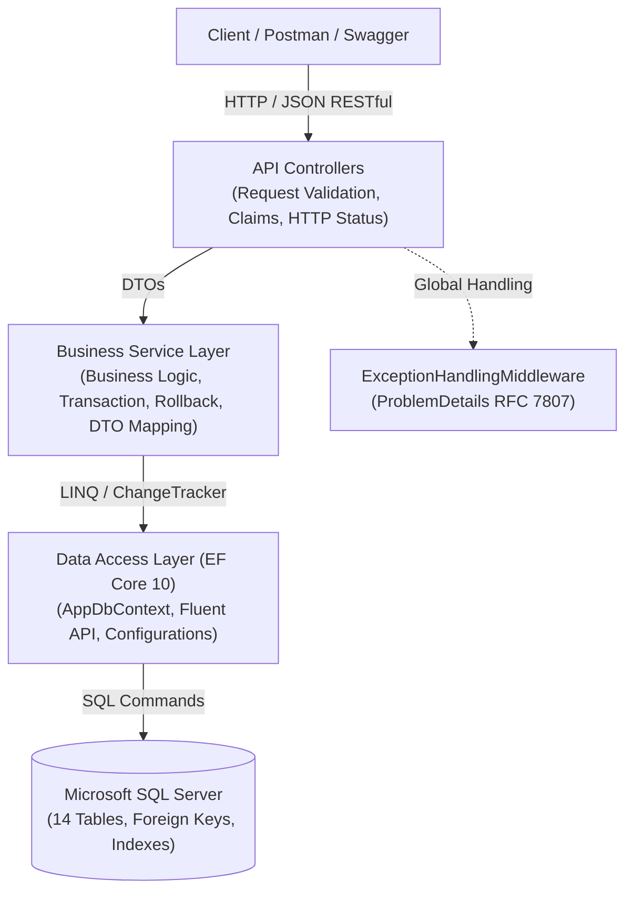

# ElectroTech Backend API — Chuyên Đề Tổng Hợp

[](https://dotnet.microsoft.com/)
[](https://learn.microsoft.com/en-us/dotnet/csharp/)
[](https://dotnet.microsoft.com/apps/aspnet/apis)
[](https://learn.microsoft.com/en-us/ef/core/)
[](https://www.microsoft.com/sql-server)
[](https://xunit.net/)
[](https://jwt.io/)
[](https://swagger.io/)

---

## 📌 1. Giới thiệu Dự án & Thành viên Phụ trách

Dự án **ElectroTech** là hệ thống Web API phục vụ nền tảng Thương mại Điện tử chuyên doanh thiết bị công nghệ (Laptop, Điện thoại, Linh kiện, Phụ kiện...). Hệ thống được thiết kế theo kiến trúc Layered Architecture chuẩn công nghiệp, bảo đảm tính toàn vẹn dữ liệu giao dịch tài chính - tồn kho, phân quyền nghiêm ngặt và hỗ trợ tư vấn bán hàng bằng AI.

### Thông tin phân công trong đồ án Chuyên đề Tổng hợp:
- **Thành viên phụ trách Core Backend**: **Đào Đăng Quang**
- **GitHub**: [`DDQuang1`](https://github.com/DDQuang1)
- **Email**: `daodquang295@gmail.com`
- **Nhánh Git phụ trách**: `Dquang_backend`
- **Phạm vi mã nguồn**: `backend/src/ECommerce.Api/`, `backend/tests/ECommerce.Api.Tests/`

---

## 🚀 2. Các gói nhiệm vụ cốt lõi đã hoàn thành

| Mã nhiệm vụ | Tiêu đề | Phạm vi & Trách nhiệm chính | Trạng thái |
|---|---|---|:---:|
| **BE-01** | **Database Schema, Migrations, JWT Auth & Catalog APIs** | Thiết kế 14 bảng dữ liệu, cấu hình Fluent API, mã hóa mật khẩu BCrypt, cấp phát JWT Claims (`sub`, `email`, `role`), Exception Handling Middleware, CRUD danh mục và tìm kiếm/lọc sản phẩm đa tiêu chí. | **✅ Hoàn thành** |
| **BE-02** | **Customer Profile, Addresses, Cart, Checkout & Cancel Order** | Quản lý Profile, Sổ địa chỉ (chống IDOR), Giỏ hàng Server-backed đồng bộ đa thiết bị, Transaction Checkout (COD & Mock QR) trừ tồn kho an toàn, Khách hàng hủy đơn hoàn kho chống lặp. | **✅ Hoàn thành** |
| **BE-03** | **Admin Portal, Real-time Inventory, Reports & Order Lifecycle** | Quản lý danh sách người dùng, cập nhật vòng đời đơn hàng (`PENDING` → `CONFIRMED` → `SHIPPING` → `COMPLETED`/`CANCELLED`) lưu vết lịch sử, Quản lý biến động kho thời gian thực, Báo cáo doanh thu và top bán chạy. | **✅ Hoàn thành** |

---

## 🏛️ 3. Kiến trúc Hệ thống Backend

Dự án được xây dựng theo mô hình **Layered Architecture** với nguyên tắc phân tách trách nhiệm (Separation of Concerns):



### Các kỹ thuật nổi bật áp dụng:
1. **Database Transaction (ACID)**: Quá trình Checkout sử dụng `IDbContextTransaction` đảm bảo: tạo đơn hàng, snapshot giá sản phẩm, trừ số lượng tồn kho và xóa giỏ hàng trong một giao dịch nguyên tử; tự động rollback nếu xảy ra lỗi.
2. **Chống hoàn kho trùng lặp**: Luồng hủy đơn hàng (`POST /api/orders/{id}/cancel`) kiểm tra trạng thái nghiêm ngặt, chỉ cho phép hủy khi đơn ở trạng thái `PENDING` và ghi nhận lịch sử giao dịch tồn kho loại `CANCEL_ORDER`.
3. **Bảo mật & Ngăn chặn IDOR (Insecure Direct Object References)**: Mọi thao tác vào Profile, Địa chỉ, Giỏ hàng và Đơn hàng của khách hàng đều trích xuất `UserId` từ JWT Claims đã ký số, tuyệt đối không nhận `UserId` từ Client truyền lên.
4. **Auto-Auditing**: `AppDbContext.SaveChangesAsync` tự động gán `CreatedAt` và `UpdatedAt` qua `ChangeTracker`.

---

## 📋 4. Bảng Danh mục 35+ RESTful API Endpoints

### 🔐 Nhóm 1: Xác thực & Tài khoản (Authentication)
| Method | Endpoint | Quyền hạn | Mô tả chức năng |
|:---:|---|:---:|---|
| `POST` | `/api/auth/register` | Public | Đăng ký tài khoản khách hàng mới (mã hóa mật khẩu BCrypt) |
| `POST` | `/api/auth/login` | Public | Đăng nhập hệ thống, cấp phát JWT Bearer Token |

### 🛍️ Nhóm 2: Catalog Sản phẩm & Danh mục
| Method | Endpoint | Quyền hạn | Mô tả chức năng |
|:---:|---|:---:|---|
| `GET` | `/api/products` | Public | Tìm kiếm, lọc theo giá, lọc theo danh mục, phân trang |
| `GET` | `/api/products/{id}` | Public | Xem chi tiết sản phẩm theo ID |
| `POST` | `/api/products` | Admin | Thêm sản phẩm mới kèm hình ảnh và số lượng kho |
| `PUT` | `/api/products/{id}` | Admin | Cập nhật thông tin và giá sản phẩm |
| `DELETE` | `/api/products/{id}` | Admin | Xóa sản phẩm (Soft delete) |
| `GET` | `/api/categories` | Public | Lấy danh sách danh mục sản phẩm |
| `GET` | `/api/categories/{id}` | Public | Lấy chi tiết danh mục |
| `POST` | `/api/categories` | Admin | Tạo danh mục mới |
| `PUT` | `/api/categories/{id}` | Admin | Cập nhật danh mục |
| `DELETE` | `/api/categories/{id}` | Admin | Xóa danh mục |

### 👤 Nhóm 3: Hồ sơ Cá nhân & Sổ Địa chỉ (Customer)
| Method | Endpoint | Quyền hạn | Mô tả chức năng |
|:---:|---|:---:|---|
| `GET` | `/api/profile` | Customer | Xem thông tin tài khoản người dùng đăng nhập |
| `PUT` | `/api/profile` | Customer | Cập nhật tên, số điện thoại |
| `GET` | `/api/addresses` | Customer | Lấy danh sách địa chỉ nhận hàng của khách |
| `POST` | `/api/addresses` | Customer | Thêm địa chỉ nhận hàng mới |
| `PUT` | `/api/addresses/{id}` | Customer | Sửa thông tin địa chỉ nhận hàng |
| `DELETE` | `/api/addresses/{id}` | Customer | Xóa địa chỉ nhận hàng |
| `PUT` | `/api/addresses/{id}/default` | Customer | Đặt làm địa chỉ giao hàng mặc định |

### 🛒 Nhóm 4: Giỏ hàng Trực tuyến (Server-backed Cart)
| Method | Endpoint | Quyền hạn | Mô tả chức năng |
|:---:|---|:---:|---|
| `GET` | `/api/cart` | Customer | Lấy chi tiết giỏ hàng và tổng tiền |
| `POST` | `/api/cart/items` | Customer | Thêm sản phẩm vào giỏ hàng (kiểm tra tồn kho) |
| `PUT` | `/api/cart/items/{itemId}` | Customer | Cập nhật số lượng của sản phẩm trong giỏ |
| `DELETE` | `/api/cart/items/{itemId}` | Customer | Xóa 1 item khỏi giỏ hàng |
| `DELETE` | `/api/cart` | Customer | Xóa toàn bộ giỏ hàng |

### 📦 Nhóm 5: Đặt hàng & Quản lý Đơn hàng (Orders & Checkout)
| Method | Endpoint | Quyền hạn | Mô tả chức năng |
|:---:|---|:---:|---|
| `POST` | `/api/orders/checkout` | Customer | Đặt hàng thanh toán COD hoặc Mock QR (Transaction trừ kho) |
| `GET` | `/api/orders` | Customer | Xem danh sách lịch sử đơn hàng của mình |
| `GET` | `/api/orders/{id}` | Customer | Xem chi tiết đơn hàng, sản phẩm và lịch sử trạng thái |
| `POST` | `/api/orders/{id}/cancel` | Customer | Hủy đơn hàng đang chờ xử lý (tự động hoàn kho) |

### 🛠️ Nhóm 6: Quản trị Hệ thống (Admin Portal)
| Method | Endpoint | Quyền hạn | Mô tả chức năng |
|:---:|---|:---:|---|
| `GET` | `/api/admin/users` | Admin | Quản lý danh sách người dùng (phân trang, tìm kiếm) |
| `GET` | `/api/admin/orders` | Admin | Quản lý toàn bộ đơn hàng trong hệ thống |
| `GET` | `/api/admin/orders/{orderId}` | Admin | Xem chi tiết đơn hàng quản trị |
| `PUT` | `/api/admin/orders/{orderId}/status`| Admin | Chuyển trạng thái đơn và ghi vết người thao tác |

### 📊 Nhóm 7: Quản lý Kho & Báo cáo Doanh thu (Inventory & Reports)
| Method | Endpoint | Quyền hạn | Mô tả chức năng |
|:---:|---|:---:|---|
| `GET` | `/api/inventory` | Admin | Tra cứu số lượng tồn kho theo từ khóa |
| `PUT` | `/api/inventory/{productId}` | Admin | Nhập hàng (Import) hoặc điều chỉnh kiểm kê (Adjustment) |
| `GET` | `/api/inventory/{productId}/transactions` | Admin | Lịch sử biến động tồn kho chi tiết |
| `GET` | `/api/reports/summary` | Admin | Thống kê Dashboard: doanh thu, số đơn, người dùng |
| `GET` | `/api/reports/revenue` | Admin | Báo cáo doanh thu theo khoảng thời gian (`from`, `to`) |
| `GET` | `/api/reports/top-products` | Admin | Top sản phẩm có số lượng bán cao nhất |

### 🤖 Nhóm 8: Trợ lý AI & Kiểm tra Hệ thống
| Method | Endpoint | Quyền hạn | Mô tả chức năng |
|:---:|---|:---:|---|
| `POST` | `/api/chat` | Public | Tư vấn cấu hình, ngân sách mua hàng qua Google Gemini AI |
| `GET` | `/api/health` | Public | Kiểm tra trạng thái hoạt động của Web API |

---

## 💻 5. Hướng dẫn Khởi chạy Dự án (Quickstart)

### Yêu cầu môi trường:
- [.NET SDK 9.0 hoặc 10.0](https://dotnet.microsoft.com/download)
- Microsoft SQL Server (LocalDB hoặc SQL Server Express)

### Bước 1: Khởi tạo Cấu hình & Database
1. Kiểm tra cấu hình chuỗi kết nối trong `backend/src/ECommerce.Api/appsettings.json`:
```json
"ConnectionStrings": {
  "ECommerce": "Server=.\\SQLEXPRESS;Database=ElectronicsStoreDBs;Trusted_Connection=True;TrustServerCertificate=True"
}
```
2. Thực hiện cập nhật Database qua EF Core Migration:
```powershell
dotnet ef database update --project backend/src/ECommerce.Api --startup-project backend/src/ECommerce.Api
```

### Bước 2: Chạy Web API
```powershell
dotnet run --project backend/src/ECommerce.Api --launch-profile http
```
- Endpoint API cơ sở: `http://localhost:5296`
- Giao diện tài liệu tương tác Swagger: `http://localhost:5296/swagger`

### Bước 3: Tài khoản thử nghiệm mặc định
| Vai trò | Email đăng nhập | Mật khẩu mặc định |
|---|---|---|
| **Quản trị viên (Admin)** | `admin@example.test` | `Admin@123456` |
| **Khách hàng mẫu (Customer)** | `customer@example.test` | `Customer@123456` |

---

## 🧪 6. Kiểm thử Tự động & Thủ công

### Kiểm thử Tự động (Unit & Integration Tests)
Chạy toàn bộ 25+ test classes kiểm thử độc lập cho Services, Controllers, Security và Persistence Boundary:
```powershell
dotnet test backend/ECommerce.slnx --configuration Release
```

### Kiểm thử Trực tiếp qua Visual Studio / VS Code REST Client
Dự án đã tích hợp sẵn bộ kiểm thử kịch bản đầy đủ tại:
📂 [`backend/src/ECommerce.Api/ECommerce.Api.http`](backend/src/ECommerce.Api/ECommerce.Api.http)

Bạn chỉ cần mở file trong VS Code hoặc Visual Studio và nhấn **Send Request** để chạy trực tiếp từng luồng nghiệp vụ.

---

## 📚 7. Tài liệu Kiến trúc & Sơ đồ Thiết kế

- 📖 **[Tài liệu Tổng Hợp Toàn Diện & Ôn Thi Vấn Đáp Đồ Án](docs/TOM_TAT_DU_AN_VA_BACKEND.md)**
- 📊 **[Báo cáo Phân Công Công Việc Chi Tiết](docs/PHAN_CONG_CONG_VIEC.md)**
- 📈 **[Báo Cáo Nghiệm Thu Công Việc Backend Đào Đăng Quang](docs/tien-do/BE_DANG_QUANG.md)**
- 📐 **Sơ đồ thiết kế (Diagrams)**:
  - [Use Case Khách hàng](docs/diagrams/use-case/use-case-customer.png) | [Use Case Quản trị viên](docs/diagrams/use-case/use-case-admin.png)
  - [BPMN Đặt hàng COD](docs/diagrams/bpmn/bpmn-dat-hang-cod.png) | [BPMN Quản lý Đơn hàng](docs/diagrams/bpmn/bpmn-quan-ly-don-hang.png) | [BPMN Quản lý Tồn kho](docs/diagrams/bpmn/bpmn-quan-ly-ton-kho.png)
  - [BPMN Đăng ký](docs/diagrams/bpmn/bpmn-registration.svg) | [BPMN Đăng nhập](docs/diagrams/bpmn/bpmn-login.svg)
  - [Sequence Diagram Đặt hàng COD](docs/diagrams/sequence/sequence-dat-hang-cod.png)

---
*Bản quyền © 2026 — Nhóm phát triển ElectroTech (Môn học Chuyên đề Tổng hợp).*
