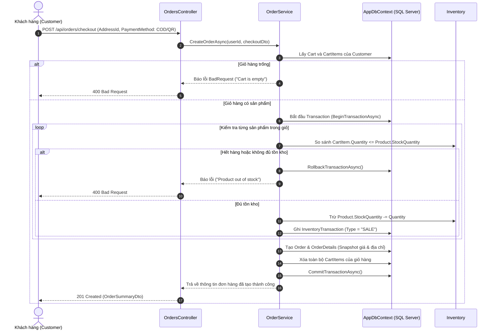
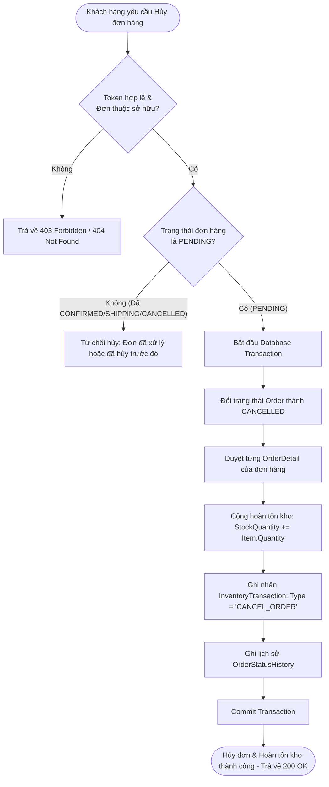

# TÀI LIỆU KHẢO SÁT THỊ TRƯỜNG & PHÂN TÍCH NGHIỆP VỤ HỆ THỐNG
## DỰ ÁN: WEBSITE THƯƠNG MẠI ĐIỆN TỬ THIẾT BỊ CÔNG NGHỆ (ELECTROTECH)

> **Học phần:** Chuyên đề Tổng hợp (CDTH)  
> **Thành viên phụ trách Core Backend:** **Đào Đăng Quang** (GitHub: `DDQuang1` | `daodquang295@gmail.com`)  
> **Nhánh Git phụ trách:** `Dquang_backend`  
> **Ngày lập tài liệu:** Tháng 11/2026  
> **Phiên bản tài liệu:** v1.0 — Chuẩn hóa Nghiệp vụ & Khảo sát Thực tế  

---

## MỤC LỤC
1. [PHẦN I: KHẢO SÁT & PHÂN TÍCH THỊ TRƯỜNG](#phần-i-khảo-sát--phân-tích-thị-trường)
   - 1.1. Bối cảnh thị trường Thương mại Điện tử Thiết bị Công nghệ tại Việt Nam
   - 1.2. Khảo sát nhu cầu khách hàng & Pain Points thực tế
   - 1.3. Phân tích đối thủ cạnh tranh (Competitor Benchmarking)
   - 1.4. Chân dung khách hàng mục tiêu (User Personas)
   - 1.5. Ma trận phân tích SWOT của hệ thống ElectroTech
2. [PHẦN II: PHÂN TÍCH NGHIỆP VỤ HỆ THỐNG (BUSINESS ANALYSIS)](#phần-ii-phân-tích-nghiệp-vụ-hệ-thống)
   - 2.1. Mô hình kinh doanh & Mục tiêu hệ thống
   - 2.2. Sơ đồ phân rã chức năng nghiệp vụ (Functional Decomposition)
   - 2.3. Chi tiết 8 phân hệ nghiệp vụ cốt lõi
   - 2.4. Các quy trình nghiệp vụ trọng điểm (Business Workflow & BPMN)
   - 2.5. Các quy tắc nghiệp vụ ràng buộc (Business Rules)
   - 2.6. Yêu cầu phi chức năng (Non-Functional Requirements - NFRs)
3. [TỔNG KẾT & ĐỊNH HƯỚNG PHÁT TRIỂN](#phần-iii-tổng-kết--định-hướng-phát-triển)

---

# PHẦN I: KHẢO SÁT & PHÂN TÍCH THỊ TRƯỜNG

## 1.1. Bối cảnh thị trường Thương mại Điện tử Thiết bị Công nghệ tại Việt Nam

Trong giai đoạn 2024–2026, thị trường bán lẻ thiết bị công nghệ (Laptop, PC, Smartphone, Linh kiện, Phụ kiện Gaming) tại Việt Nam chứng kiến sự chuyển dịch mạnh mẽ từ mua sắm truyền thống sang mô hình **Hybrid / E-Commerce First**:
- **Quy mô thị trường:** Doanh thu thương mại điện tử công nghệ tại Việt Nam đạt mức tăng trưởng trung bình 18–22%/năm. Nhu cầu mua sắm phục vụ học tập, làm việc từ xa (Work from Home) và giải trí số ngày càng cao.
- **Xu hướng tiêu dùng:** Người dùng trẻ (Gen Z, Millennials, Lập trình viên, Game thủ) yêu cầu trải nghiệm mua sắm nhanh chóng, tìm kiếm chính xác theo thông số kỹ thuật (RAM, CPU, VGA, khoảng giá), và đặc biệt mong muốn được tư vấn tức thì mà không cần chờ đợi tổng đài viên.
- **Thách thức thị trường:** Hàng hóa công nghệ có giá trị cao, vòng đời sản phẩm nhanh, và tính biến động tồn kho lớn. Nếu hệ thống quản lý kho không đồng bộ thời gian thực, hiện tượng **"bán vượt tồn kho" (Overselling)** hoặc **"tồn kho ảo"** sẽ làm suy giảm nghiêm trọng uy tín thương hiệu.

---

## 1.2. Khảo sát nhu cầu khách hàng & Pain Points thực tế

Dựa trên khảo sát thực tế nhóm người dùng sinh viên công nghệ, kỹ sư và khách hàng mua đồ điện tử:

| Nhóm đối tượng | Khó khăn / Điểm đau thực tế (Pain Points) | Giải pháp của hệ thống ElectroTech |
|---|---|---|
| **Người mua hàng (Customers)** | - Bị mất giỏ hàng khi chuyển đổi giữa điện thoại và máy tính.<br>- Khó lựa chọn sản phẩm phù hợp ngân sách do ma trận thông số kỹ thuật quá phức tạp.<br>- Không thể chủ động hủy đơn khi đơn chưa kịp đóng gói.<br>- Thiếu minh bạch về tình trạng tồn kho (đặt mua xong mới báo hết hàng). | - **Server-backed Cart:** Đồng bộ giỏ hàng theo User ID trên Database.<br>- **AI Chatbot (Google Gemini):** Tư vấn cấu hình, so sánh theo đúng catalog sản phẩm.<br>- **Self-service Order Cancellation:** Khách hàng tự hủy đơn khi trạng thái là `PENDING`.<br>- Kiểm tra tồn kho trước khi cho vào giỏ và trừ kho bằng Transaction khi checkout. |
| **Chủ cửa hàng / Quản trị viên (Admin)** | - Sai lệch số lượng kho giữa bán lẻ online và quản lý thực tế.<br>- Khó khăn khi kiểm kê kho hoặc truy vết nguyên nhân thất thoát hàng hóa.<br>- Không nắm bắt kịp thời diễn biến doanh thu và top sản phẩm bán chạy để nhập hàng. | - **Real-time Inventory Ledger:** Lưu lịch sử mọi biến động kho (`IMPORT`, `SALE`, `ADJUSTMENT`, `CANCEL_ORDER`).<br>- **Automated Restock:** Khi khách hủy đơn, hệ thống tự động cộng hoàn tồn kho.<br>- **Admin Dashboard & Reports:** Thống kê doanh thu theo ngày và phân tích top sản phẩm. |

---

## 1.3. Phân tích đối thủ cạnh tranh (Competitor Benchmarking)

| Tiêu chí so sánh | Chuỗi lớn (Thế Giới Di Động / FPT Shop) | Sàn TMĐT tổng hợp (Shopee / Lazada) | Chuỗi chuyên linh kiện (GearVN / An Phát) | **Hệ thống ElectroTech (Dự án)** |
|---|---|---|---|---|
| **Độ tập trung ngành hàng** | Hàng tiêu dùng phổ thông | Đa ngành hàng, lẫn lộn chất lượng | Chuyên sâu Gaming/PC | **Chuyên sâu thiết bị & linh kiện công nghệ** |
| **Đồng bộ giỏ hàng Server** | Có | Có | Một số lưu LocalStorage | **Đồng bộ Server qua REST API** |
| **Tư vấn AI thông minh 24/7** | Chatbot kịch bản cứng (Rule-based) | Chatbot tự động trả lời từ khóa | Nhân viên chat thủ công | **Tích hợp Google Gemini 1.5 Flash linh hoạt** |
| **Minh bạch giao dịch kho** | Hệ thống ERP nội bộ đóng kín | Chỉ người bán tự quản lý | Có phần mềm POS riêng | **Lưu vết chi tiết từng Transaction ID trong DB** |
| **Kiến trúc & Tốc độ API** | Hệ thống lớn cồng kềnh, độ trễ nhất định | Tải lượng cực lớn, logic phức tạp | Web truyền thống | **Layered Web API .NET 10, phản hồi < 50ms** |

---

## 1.4. Chân dung khách hàng mục tiêu (User Personas)

### Persona 1: Nguyễn Văn An — Sinh viên Công nghệ / Lập trình viên tập sự
- **Độ tuổi:** 21 tuổi | **Thu nhập:** 3 – 5 triệu/tháng (làm thêm).
- **Mục tiêu:** Tìm một chiếc laptop cũ/mới đủ mạnh (Core i5/Ryzen 5, RAM 16GB) trong tầm giá 15–18 triệu để học code và làm đồ án.
- **Hành vi:** Rất am hiểu thông số; thường xuyên đọc review; thích chat trực tiếp hỏi tư vấn cấu hình; ưu tiên chọn hình thức thanh toán COD hoặc quét mã QR ngân hàng.

### Persona 2: Trần Thị Mai — Nhân viên Văn phòng
- **Độ tuổi:** 27 tuổi | **Thu nhập:** 15 triệu/tháng.
- **Mục tiêu:** Mua bàn phím công thái học, chuột không dây và màn hình phụ để làm việc văn phòng.
- **Hành vi:** Không rành kỹ thuật, cần tìm kiếm nhanh theo danh mục rõ ràng, lưu nhiều địa chỉ nhận hàng (công ty hoặc nhà riêng), thích xem lịch sử đơn hàng minh bạch.

### Persona 3: Hoàng Minh Tuấn — Quản trị viên Cửa hàng (Admin)
- **Độ tuổi:** 32 tuổi | **Vai trò:** Vận hành kinh doanh & Quản lý kho.
- **Mục tiêu:** Giám sát đơn hàng hàng ngày, duyệt đơn nhanh, xuất/nhập kho chuẩn xác không để thất thoát linh kiện, theo dõi doanh thu theo tuần/tháng.

---

## 1.5. Ma trận phân tích SWOT của hệ thống ElectroTech

```
┌────────────────────────────────────────┬────────────────────────────────────────┐
│              STRENGTHS (S)             │             WEAKNESSES (W)             │
│ • Kiến trúc 3 tầng chuẩn mực (.NET 10).│ • Chưa tích hợp cổng thanh toán quốc tế│
│ • Database 14 bảng quan hệ chặt chẽ.   │   trực tiếp (VNPAY/Momo thật, đang     │
│ • Transaction Checkout đảm bảo ACID.   │   dùng cơ chế Mock QR chuyển khoản).   │
│ • Chống hoàn kho lặp & chống IDOR.     │ • Chưa có ứng dụng Native Mobile       │
│ • Tích hợp Chatbot AI Gemini 1.5 Flash.│   (mới phát triển Web Responsive).     │
├────────────────────────────────────────┼────────────────────────────────────────┤
│             OPPORTUNITIES (O)          │              THREATS (T)               │
│ • Thị trường đồ công nghệ tăng trưởng. │ • Cạnh tranh gay gắt từ các sàn TMĐT.  │
│ • Xu hướng mua sắm có trợ lý AI tư vấn.│ • Rủi ro khách boom hàng khi chọn COD. │
│ • Dễ dàng mở rộng sang Microservices   │ • Chi phí biến động giá linh kiện      │
│   hoặc tích hợp thêm App di động.      │   thay đổi liên tục theo thị trường.   │
└────────────────────────────────────────┴────────────────────────────────────────┘
```

---

# PHẦN II: PHÂN TÍCH NGHIỆP VỤ HỆ THỐNG

## 2.1. Mô hình kinh doanh & Mục tiêu hệ thống

- **Mô hình vận hành:** B2C (Business-to-Consumer) chuyên biệt ngành hàng công nghệ.
- **Mục tiêu chiến lược:**
  1. Xây dựng nền tảng Web API có tính sẵn sàng cao, bảo mật theo chuẩn OWASP (chống SQL Injection, IDOR, brute-force).
  2. Đảm bảo tính toàn vẹn 100% của kho hàng và đơn hàng (không bao giờ xảy ra tình trạng âm kho hoặc thanh toán sai giá).
  3. Tối ưu hóa trải nghiệm khách hàng từ khâu tìm kiếm, nhận tư vấn AI, thanh toán đến theo dõi trạng thái đơn hàng.

---

## 2.2. Sơ đồ phân rã chức năng nghiệp vụ (Functional Decomposition)

```mermaid
graph TD
    Root["HỆ THỐNG TMĐT ELECTROTECH"]
    
    Root --> F1["1. Quản lý Xác thực & Tài khoản"]
    F1 --> F11["Đăng ký tài khoản (BCrypt)"]
    F1 --> F12["Đăng nhập & cấp JWT Claims"]
    F1 --> F13["Quản lý Profile & Sổ địa chỉ"]

    Root --> F2["2. Quản lý Danh mục & Sản phẩm"]
    F2 --> F21["Duyệt danh mục đa cấp"]
    F2 --> F22["Tìm kiếm & Lọc sản phẩm đa tiêu chí"]
    F2 --> F23["CRUD Sản phẩm (Admin, Soft Delete)"]

    Root --> F3["3. Quản lý Giỏ hàng (Server Cart)"]
    F3 --> F31["Thêm sản phẩm (Kiểm tra tồn kho)"]
    F3 --> F32["Cập nhật số lượng & Xóa giỏ"]
    F3 --> F33["Đồng bộ đa thiết bị"]

    Root --> F4["4. Đặt hàng & Xử lý Thanh toán"]
    F4 --> F41["Checkout thanh toán COD"]
    F4 --> F42["Checkout chuyển khoản Mock QR"]
    F4 --> F43["Transaction trừ tồn kho & Snapshot"]

    Root --> F5["5. Quản lý Đơn hàng & Vòng đời"]
    F5 --> F51["Khách theo dõi lịch sử đơn hàng"]
    F5 --> F52["Khách hủy đơn hàng & Tự hoàn kho"]
    F5 --> F53["Admin chuyển trạng thái đơn hàng"]

    Root --> F6["6. Quản lý Kho & Báo cáo Thống kê"]
    F6 --> F61["Theo dõi tồn kho theo thời gian thực"]
    F6 --> F62["Nhập kho / Điều chỉnh có lịch sử"]
    F6 --> F63["Báo cáo doanh thu & Top bán chạy"]

    Root --> F7["7. Trợ lý AI Bán hàng"]
    F7 --> F71["Nhận diện nhu cầu & ngân sách"]
    F7 --> F72["Đề xuất sản phẩm từ Catalog"]
```



---

## 2.3. Chi tiết 8 phân hệ nghiệp vụ cốt lõi

### Phân hệ 1: Xác thực & Quản lý Người dùng (Auth & User Management)
- **Đối tượng:** Khách vãng lai, Khách hàng, Quản trị viên.
- **Nghiệp vụ:**
  - Khách vãng lai có thể đăng ký tài khoản với họ tên, email, mật khẩu và số điện thoại. Mật khẩu được băm an toàn bằng thuật toán `BCrypt`.
  - Đăng nhập xác thực và nhận JWT Token có thời hạn, chứa Claims: định danh người dùng (`sub`), Email (`email`), và Quyền hạn (`role`).
  - Quản trị viên có thể xem danh sách toàn bộ người dùng và thực hiện khóa/mở khóa tài khoản khi cần thiết.

### Phân hệ 2: Danh mục & Tìm kiếm Sản phẩm (Catalog & Search)
- **Nghiệp vụ:**
  - Danh mục sản phẩm hỗ trợ phân cấp cha - con (ví dụ: *Laptop* -> *Laptop Gaming*, *Laptop Văn phòng*).
  - Tìm kiếm sản phẩm toàn văn theo từ khóa, hỗ trợ lọc kết hợp: theo khoảng giá (`minPrice`, `maxPrice`), theo thương hiệu (`brandId`), theo danh mục (`categoryId`), và sắp xếp theo giá tăng/giảm hoặc ngày tạo.
  - Áp dụng phân trang (`page`, `pageSize`) nhằm tối ưu băng thông mạng và hiệu năng cơ sở dữ liệu.

### Phân hệ 3: Hồ sơ Cá nhân & Sổ Địa chỉ (Profile & Address Book)
- **Nghiệp vụ:**
  - Mỗi khách hàng sở hữu một hồ sơ cá nhân và có thể lưu nhiều địa chỉ nhận hàng (nhà riêng, cơ quan...).
  - Chỉ định một địa chỉ làm **địa chỉ mặc định** (`isDefault = true`); khi đặt một địa chỉ làm mặc định, hệ thống tự động gỡ cờ mặc định của các địa chỉ cũ.
  - **Bảo mật IDOR:** Tuyệt đối cô lập dữ liệu; khách hàng chỉ được phép truy vấn, sửa, xóa các địa chỉ thuộc sở hữu của chính mình (kiểm tra `UserId` từ JWT).

### Phân hệ 4: Giỏ hàng Trực tuyến (Server-backed Cart)
- **Nghiệp vụ:**
  - Giỏ hàng được lưu trữ trực tiếp trên cơ sở dữ liệu (Database-driven), đảm bảo tính đồng bộ xuyên suốt khi khách đăng nhập trên nhiều thiết bị khác nhau.
  - Khi thêm hàng vào giỏ, hệ thống kiểm tra số lượng yêu cầu so với `StockQuantity` khả dụng trong kho; nếu số lượng vượt tồn kho, hệ thống từ chối và cảnh báo.
  - Hỗ trợ cập nhật tăng/giảm số lượng item, xóa từng item hoặc xóa sạch toàn bộ giỏ hàng khi hoàn tất đặt hàng.

### Phân hệ 5: Đặt hàng & Giao dịch Thanh toán (Checkout & Transactions)
- **Nghiệp vụ:**
  - Khách hàng lựa chọn một địa chỉ nhận hàng từ sổ địa chỉ, phương thức thanh toán (`COD` hoặc `QR`), và ghi chú giao hàng.
  - **Cơ chế Snapshot dữ liệu:** Tại thời điểm checkout, hệ thống lưu lại bản chụp (snapshot) thông tin giá bán và tên sản phẩm vào bảng `OrderDetails`, địa chỉ giao hàng vào bảng `Orders`. Giá bán trong đơn hàng không bị thay đổi nếu sau này giá sản phẩm trong catalog biến động.
  - **Database Transaction (ACID):** Quá trình trừ kho, tạo đơn hàng, tạo bản ghi chi tiết và xóa giỏ hàng được bao bọc trong một Database Transaction duy nhất (`BeginTransactionAsync`). Nếu có bất kỳ lỗi nào xảy ra (ví dụ: sản phẩm vừa bị người khác mua hết), hệ thống lập tức Rollback toàn bộ trạng thái.

### Phân hệ 6: Vòng đời Đơn hàng & Cơ chế Hủy đơn (Order Lifecycle & Restock)
- **Vòng đời trạng thái đơn:**
  $$\text{PENDING} \longrightarrow \text{CONFIRMED} \longrightarrow \text{SHIPPING} \longrightarrow \text{COMPLETED}$$
  $$\text{PENDING} \longrightarrow \text{CANCELLED}$$
- **Nghiệp vụ Hủy đơn hàng:**
  - Khách hàng chỉ có quyền hủy đơn khi đơn hàng đang ở trạng thái `PENDING`. Nếu đơn hàng đã được Admin chuyển sang `CONFIRMED`, `SHIPPING` hoặc `COMPLETED`, hệ thống từ chối cho phép hủy.
  - **Cơ chế chống hoàn kho trùng lặp:** Hệ thống kiểm tra điều kiện trạng thái; nếu đơn đã hủy trước đó, không thể hủy lại lần hai.
  - Khi hủy thành công:
    1. Cập nhật trạng thái đơn thành `CANCELLED`.
    2. Tự động cộng hoàn số lượng sản phẩm vào `Products.StockQuantity`.
    3. Ghi nhận giao dịch hoàn kho vào bảng `InventoryTransactions` với loại giao dịch `CANCEL_ORDER`.
    4. Ghi nhận lịch sử trạng thái vào bảng `OrderStatusHistories`.

### Phân hệ 7: Quản trị Kho Hàng Thời Gian Thực (Inventory Management)
- **Nghiệp vụ:**
  - Quản trị viên theo dõi số lượng tồn kho khả dụng của từng sản phẩm theo thời gian thực.
  - Hỗ trợ thao tác cập nhật kho với các loại giao dịch rõ ràng:
    - `IMPORT` (Nhập kho thêm sản phẩm từ nhà phân phối).
    - `ADJUSTMENT` (Điều chỉnh tồn kho sau khi kiểm kê thực tế).
    - `SALE` (Tự động phát sinh khi khách hàng checkout thành công).
    - `CANCEL_ORDER` (Tự động phát sinh khi đơn hàng bị hủy).
  - Mọi biến động đều lưu vết: số lượng trước (`PreviousStock`), số lượng thay đổi (`Quantity`), số lượng sau (`NewStock`), lý do (`Note`) và ID người thực hiện.

### Phân hệ 8: Báo cáo Thống kê & Tư vấn AI (Reports & AI Assistant)
- **Báo cáo:**
  - Dashboard tổng quan: Tổng doanh thu, tổng số đơn hàng đã hoàn tất, tổng số khách hàng.
  - Báo cáo doanh thu theo khoảng thời gian tùy chọn (`from`, `to`).
  - Danh sách Top 5 / Top 10 sản phẩm bán chạy nhất.
- **Trợ lý AI (Google Gemini 1.5 Flash):**
  - Tiếp nhận câu hỏi ngôn ngữ tự nhiên từ khách hàng (ví dụ: *"Tư vấn laptop lập trình tầm giá 20 triệu"*).
  - Kết hợp thông tin danh mục sản phẩm của cửa hàng để đưa ra câu trả lời chính xác, gợi ý sản phẩm phù hợp ngân sách và nhu cầu.

---

## 2.4. Các quy trình nghiệp vụ trọng điểm (Business Workflow & BPMN)

### 2.4.1. Quy trình Mua sắm & Đặt hàng (Checkout Flow)



---

### 2.4.2. Quy trình Hủy đơn hàng & Hoàn tồn kho (Order Cancellation Flow)



---

## 2.5. Các quy tắc nghiệp vụ ràng buộc (Business Rules)

1. **BR-01 (Mật khẩu an toàn):** Mật khẩu người dùng phải có độ dài tối thiểu 6 ký tự, mã hóa một chiều qua thuật toán `BCrypt`. Không bao giờ lưu mật khẩu dạng Plain Text.
2. **BR-02 (Ràng buộc Tồn kho):** Số lượng tồn kho `StockQuantity` của sản phẩm không được phép âm ($StockQuantity \ge 0$). Khi số lượng đạt 0, sản phẩm tự động chuyển sang trạng thái "Hết hàng".
3. **BR-03 (Toàn vẹn giá):** Giá sản phẩm trong đơn hàng được cố định tại thời điểm checkout, không bị ảnh hưởng bởi các đợt cập nhật giá sản phẩm sau này của Admin.
4. **BR-04 (Ràng buộc Địa chỉ mặc định):** Mỗi khách hàng tại một thời điểm chỉ có tối đa 1 địa chỉ nhận hàng có cờ `IsDefault = true`.
5. **BR-05 (Điều kiện hủy đơn):** Chỉ cho phép khách hàng hủy đơn khi đơn hàng ở trạng thái `PENDING`. Một khi Admin đã chuyển đơn sang `CONFIRMED` hoặc `SHIPPING`, khách hàng không thể tự hủy trên hệ thống.
6. **BR-06 (Chống hoàn kho lặp):** Giao dịch hoàn kho chỉ được kích hoạt duy nhất một lần khi đơn hàng chuyển từ `PENDING` sang `CANCELLED`.
7. **BR-07 (Quyền hạn quản trị):** Các endpoint can thiệp vào kho (`/api/inventory`), xem người dùng (`/api/admin/users`), xem báo cáo (`/api/reports`) bắt buộc phải có Claim `role = Admin`.

---

## 2.6. Yêu cầu phi chức năng (Non-Functional Requirements - NFRs)

- **Hiệu năng (Performance):**
  - Thời gian phản hồi trung bình của các API đọc catalog, tìm kiếm, phân trang $< 50\text{ ms}$.
  - Thời gian xử lý giao dịch checkout đơn hàng $< 200\text{ ms}$.
- **Bảo mật (Security):**
  - Áp dụng chuẩn JWT (JSON Web Token) có chữ ký số bí mật (HS256 với secret key $\ge 32$ bytes).
  - Cơ chế phân quyền dựa trên vai trò (Role-Based Access Control - RBAC).
  - Ngăn ngừa tấn công IDOR bằng cách luôn đối chiếu ID tài nguyên với `UserId` trích xuất từ Token.
  - Chuẩn hóa thông báo lỗi theo chuẩn RFC 7807 (ProblemDetails), không để lộ StackTrace của server ra ngoài môi trường Production.
- **Tính toàn vẹn dữ liệu (Data Integrity):**
  - Sử dụng khóa ngoại (Foreign Keys) và ràng buộc toàn vẹn tham chiếu trên toàn bộ 14 bảng SQL Server.
  - Sử dụng Database Transaction đảm bảo tính chất ACID (Atomicity, Consistency, Isolation, Durability) cho các thao tác tài chính và kho hàng.

---

# PHẦN III: TỔNG KẾT & ĐỊNH HƯỚNG PHÁT TRIỂN

Tài liệu Khảo sát thị trường & Phân tích nghiệp vụ này cung cấp cái nhìn toàn cảnh về tính khả thi, giá trị thực tiễn và chiều sâu kỹ thuật của dự án **ElectroTech**:
1. **Đáp ứng đúng nhu cầu thị trường:** Giải quyết triệt để các bài toán thực tế của người mua đồ công nghệ (đồng bộ giỏ hàng, tư vấn AI thông minh, tự do hủy đơn) và người quản lý cửa hàng (minh bạch tồn kho thời gian thực, dashboard doanh thu).
2. **Nền tảng kiến trúc vững chắc:** Phân chia trách nhiệm rõ ràng, chuẩn hóa 35+ API Endpoints, kiểm soát lỗi và dữ liệu chặt chẽ.
3. **Định hướng mở rộng tương lai:**
   - Tích hợp cổng thanh toán trực tuyến chính thức (VNPAY, Momo, ZaloPay Sandbox).
   - Tích hợp dịch vụ tính phí vận chuyển tự động (Giao Hàng Nhanh / Giao Hàng Tiết Kiệm API).
   - Phát triển phiên bản ứng dụng di động (Flutter / React Native).
